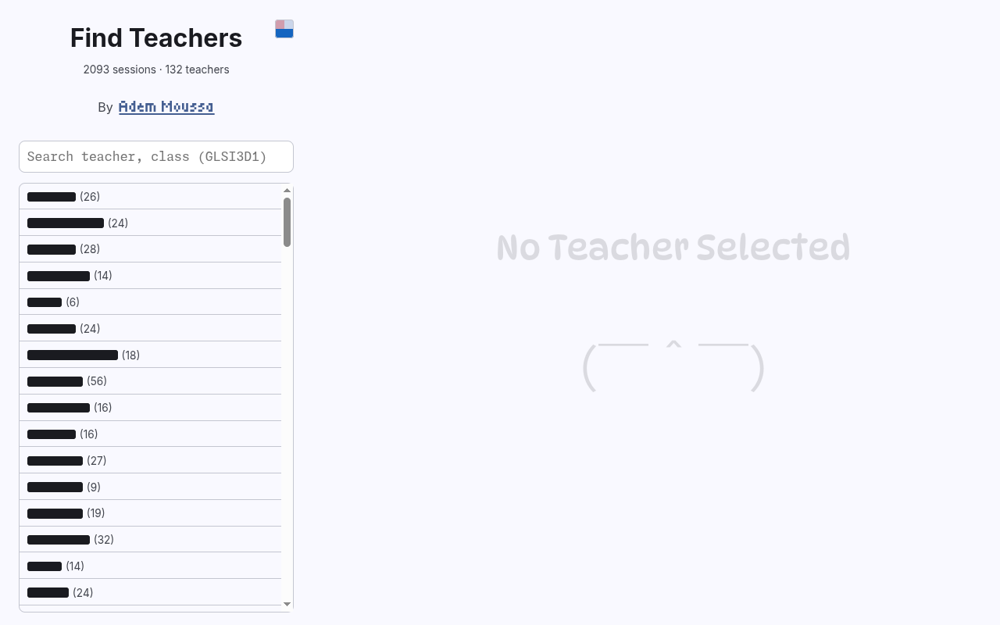
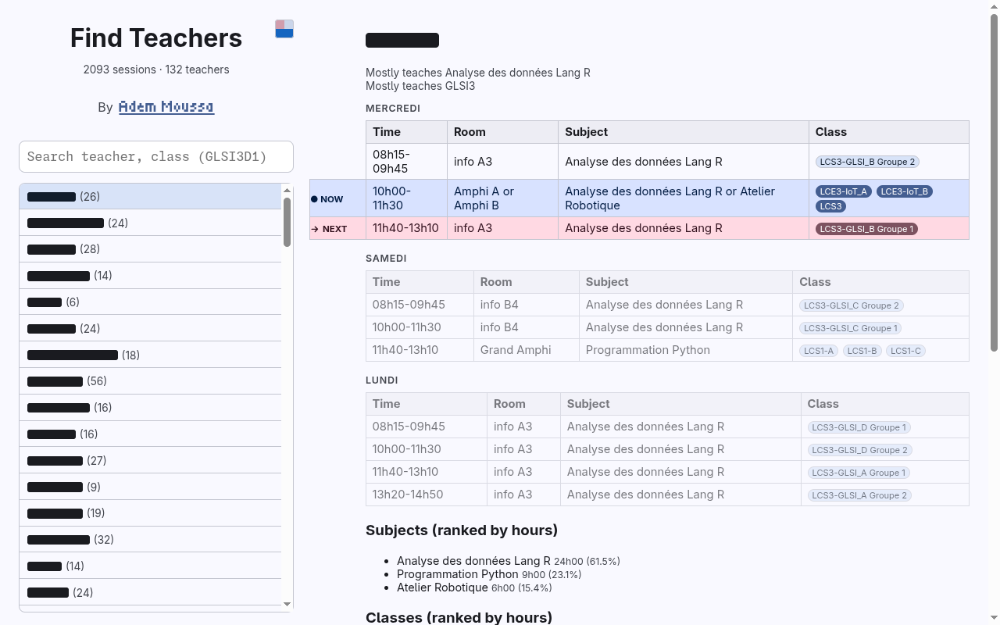
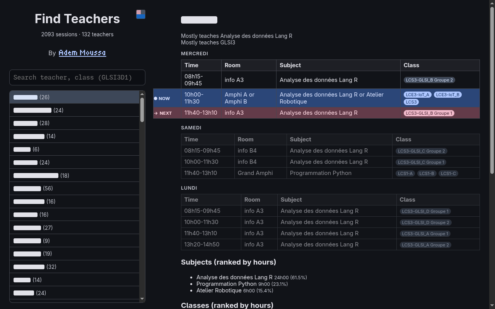
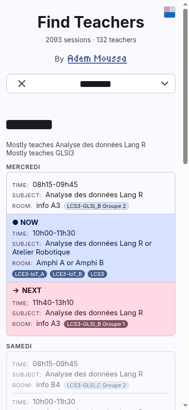
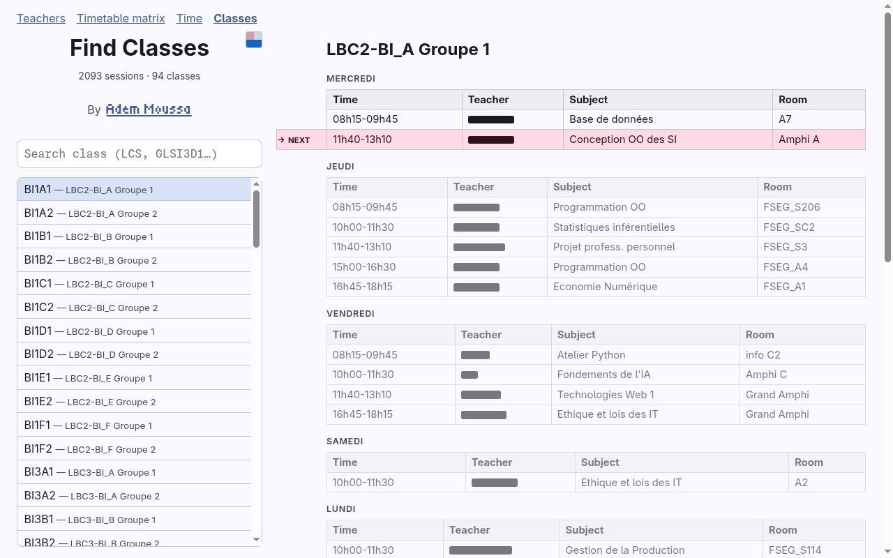
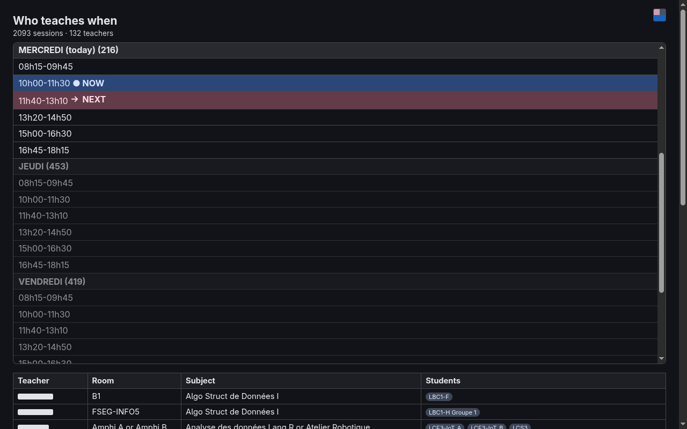
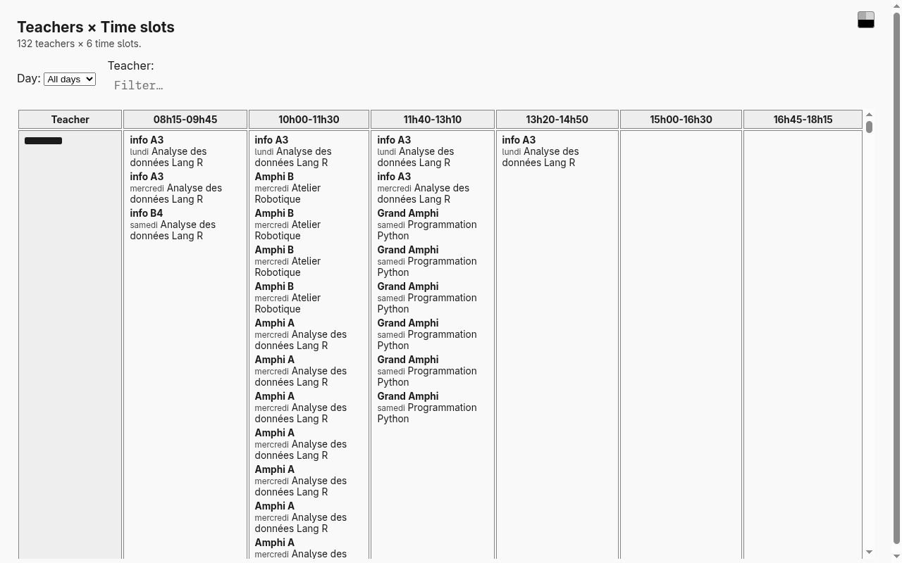

# Teacher Time

See the complete timetable of any teacher, find teachers by name, subjects they teach and their classes of students.
Data is scraped from student timetables on the official university website.

# Documentation

`CONTEXT.md` documents the context around the app, mainly the data model of the world.
`FEATURES.md` documents the features that make up the website: the snapshot model, the views, search, the theme system and the rest.

# Screenshots

Opening any page with `?redact=1` renders every teacher name as a rectangle filled with the text foreground, so the UI can be shown without any name in it; the captures below use that mode across pages, viewports and color schemes.

The teachers page on desktop: each list row shows a rectangle and a session count instead of the name.

A teacher's detail view on desktop: rectangle heading above the day-group tables.

The same detail view in dark mode — the rectangles pick up the dark foreground color.

The teachers page on a phone-sized viewport: the selected-teacher search overlay shows a rectangle.

The classes page detail: day-group tables and the whole-week grid, teacher cells redacted.

The time page's slot detail table with the Teacher column rendered as rectangles.

The full timetable matrix in the Monochrome preset: the sticky first column is all rectangles.

# Data Pipeline

raw timetable PDFs -> Python parser + scraper -> .csv source of truth
Re-running the parser updates the site; no other step is needed.

# Disclaimer

The project is vibecoded. this project exists out of necessity rather than passion.
